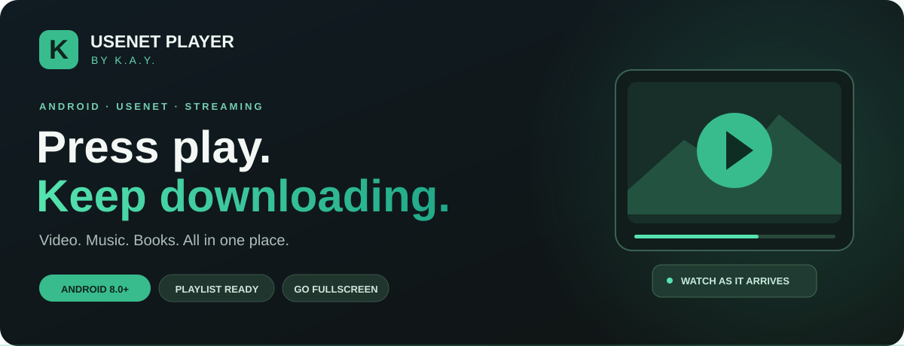

# Usenet Player by K.A.Y.

### Press play. Keep downloading.

Your Usenet, your videos, your playlists — together on Android.

**Stream while downloading · Automatic fullscreen · Video library · Custom playlists**

[Download](https://github.com/kayzaa/Usenet-Player/releases/download/v0.1.4/Usenet-Player-by-KAY-v0.1.4.apk) · [What's new](https://github.com/kayzaa/Usenet-Player/releases/tag/v0.1.4) · [Report an issue](https://github.com/kayzaa/Usenet-Player/issues)

---

## Less waiting. More watching.

Find a video, tap **Stream**, and start watching while the download continues. Usenet Player by K.A.Y. brings downloading, playback and your personal video collection into one dark, straightforward Android app.

| Feature | What you get |
| :--- | :--- |
| ▶ **Watch while downloading** | Play supported videos as data arrives, with buffering when more data is needed. |
| 🔎 **Usenet search** | Eweka / Plus integration, NZB import and compatible index configuration. |
| 🎬 **Built-in playback** | MP4, MKV and AVI playback paths, including a VLC-based AVI player. |
| ⛶ **Turn for fullscreen** | Rotate into landscape to focus on the video; rotate back to restore the download and TV controls. |
| ▤ **Your video library** | Find your app videos and ongoing streams in one dedicated tab. |
| ≡ **Make it a playlist** | Create, rename and reorder playlists. Add or remove videos and play the next item automatically. |
| 📺 **Take it to the TV** | Google Cast for compatible videos on Chromecast, Google TV and Android TV devices with Cast support. |
| 🍿 **Cinema showcase** | Browse recent theatrical releases, with language and region options. |
| ❤️ **Keep your favorites** | Save search results and manage downloads from the same app. |

## Get started

1. **[Download the latest APK](https://github.com/kayzaa/Usenet-Player/releases/download/v0.1.4/Usenet-Player-by-KAY-v0.1.4.apk)** onto your Android phone.
2. Open the APK and allow installation from your chosen browser or file manager if Android asks.
3. Open the app settings and enter your own Usenet provider credentials. Eweka is preconfigured with **TLS on port 563**.
4. Connect search or import an NZB, then choose **Download** or **Stream**.

**Already using the app?** Install this APK over your existing installation to update it. There is no need to uninstall first.

**Playlists:** Open **Videos → Playlisten (Playlists)**, create a list, and add videos from your library. Use the previous/next buttons during playback, or let the playlist advance automatically.

## What's new in v0.1.4

- Automatic fullscreen when rotating into landscape, preserving the running player and playback position.
- A dedicated **Videos** tab for your downloads and streams.
- Playlist creation, renaming, reordering and deletion without deleting the underlying videos.
- Automatic playlist progression, including transitions between MP4 and AVI.
- A smaller APK download: approximately **94 MiB**, with the same bundled playback libraries.

## A few useful details

- **Android 8.0 or newer.** The current app interface is in German; search and showcase language options are separate.
- Bring your own Usenet account and search access. No movies, NZB collection or provider subscription are included.
- Playback during download depends on the file, archive structure, codecs and available articles. Some files need more data before they can start.
- Growing AVI playback currently starts at the beginning and does not offer seeking. PAR2 repair is not included yet.
- Casting requires the phone and TV to be on the same Wi-Fi network and the receiver to support the video's container and codecs. An AVI playing locally does not guarantee that it can be cast.
- The video library lists videos managed by this app; it does not automatically scan every video on your phone.

## Downloads & feedback

This repository distributes the **Android APK** and project information. The application's source code is not included.

Found a problem? [Open an issue](https://github.com/kayzaa/Usenet-Player/issues) with your Android version, phone model, app version and the error shown. Please leave passwords, access tokens and private download links out of reports.

Third-party notices are included in the APK. This is an independent project, not an official Momentum or Eweka application.

---

**Built by K.A.Y. · Made for your next movie night.**

[▶ Follow @traderlifestyle on YouTube](https://www.youtube.com/@traderlifestyle)

